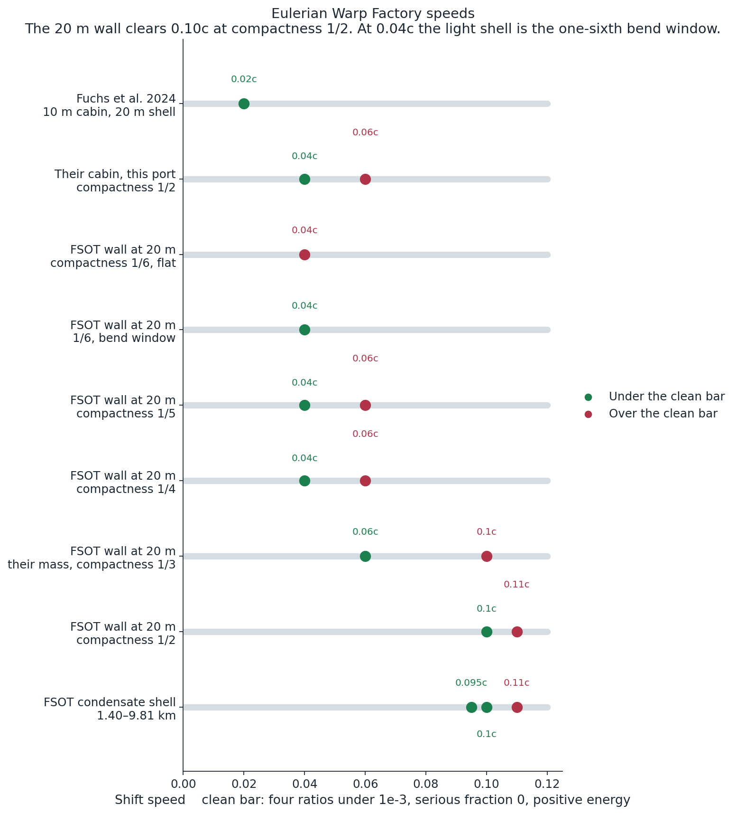
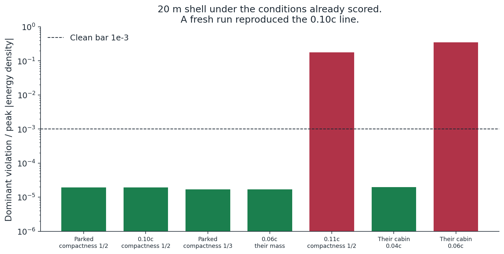
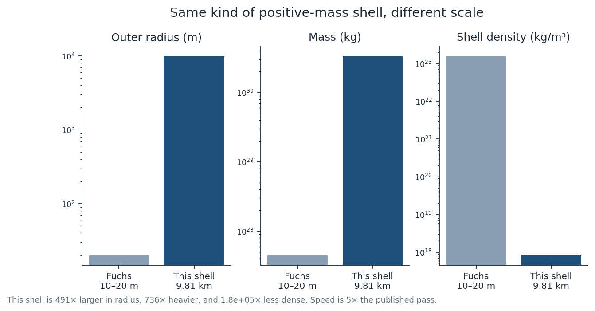
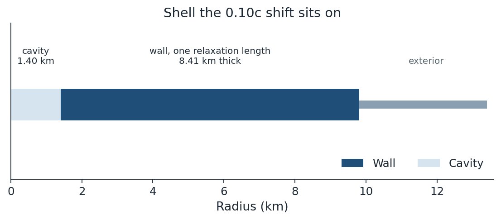
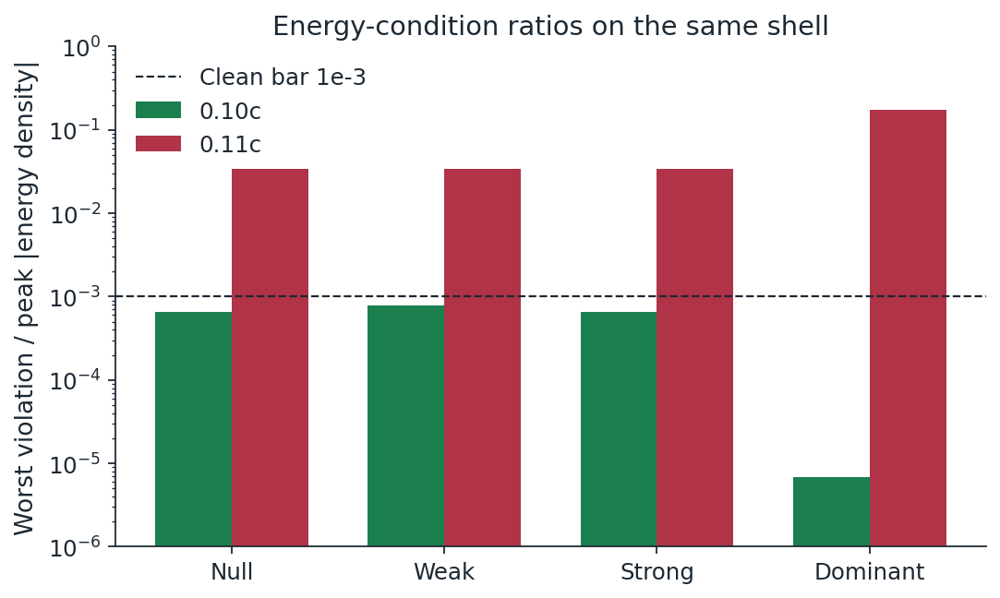
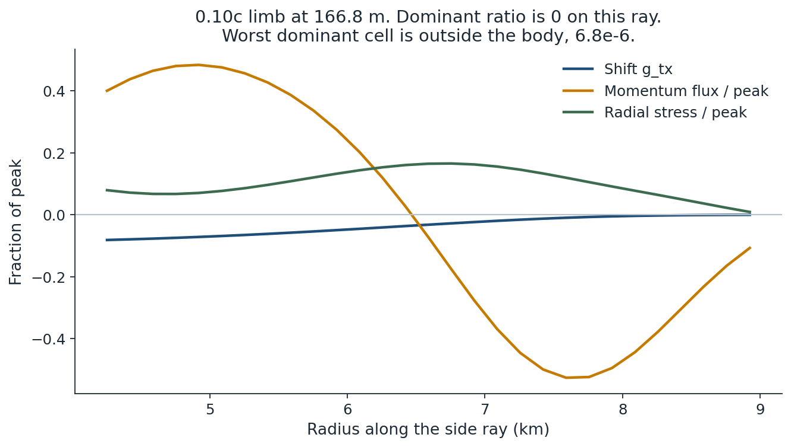
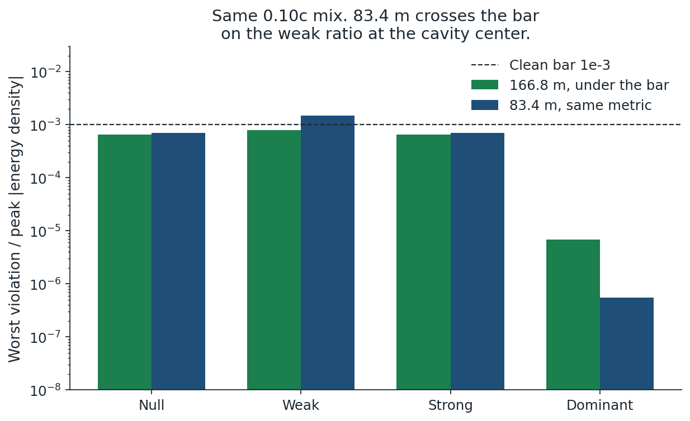
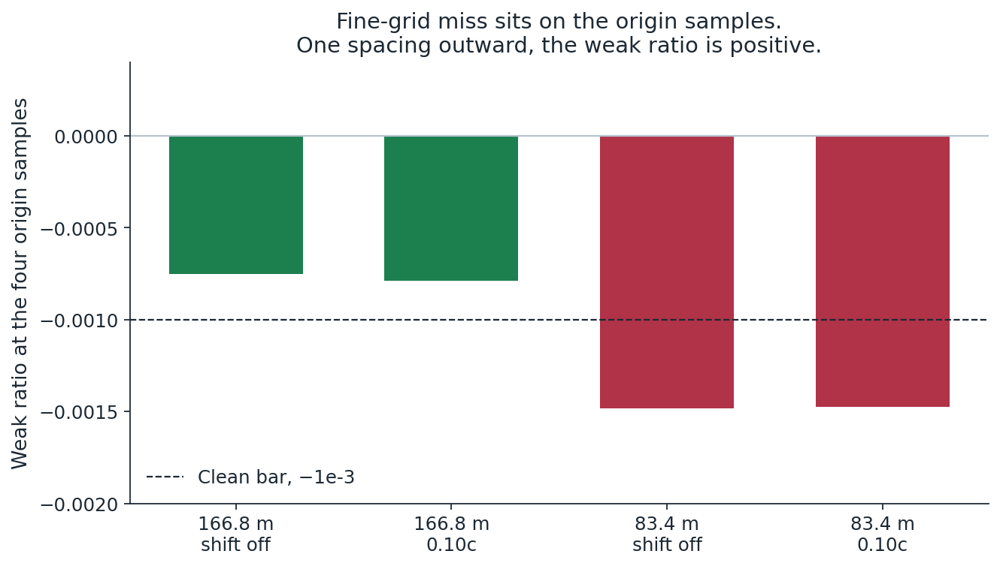
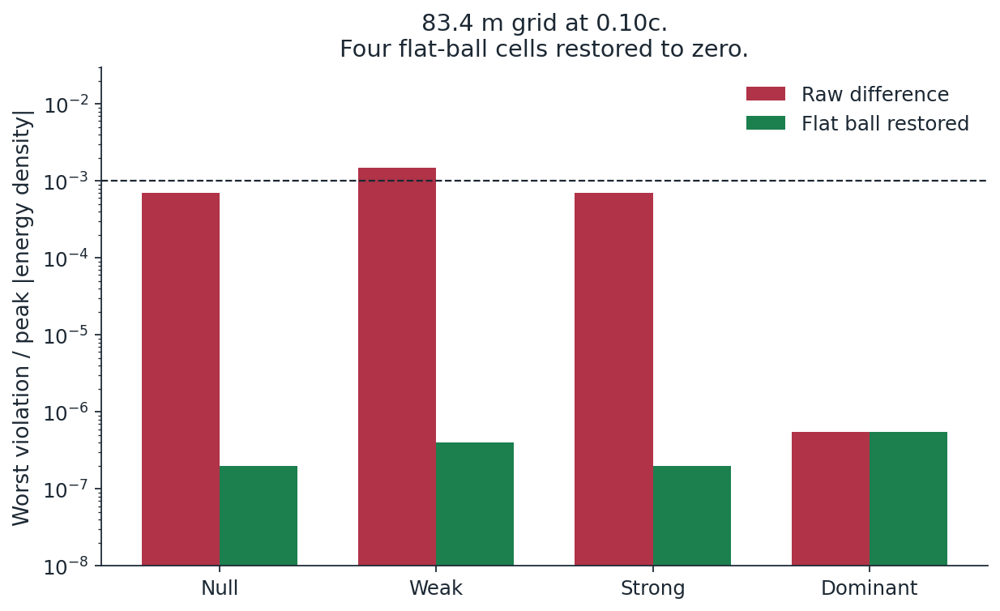

# FSOT warp shell

**Author:** Damian Arthur Palumbo  
**License:** Apache-2.0  
**Pin:** FSOT 2.1 AEB2AD, from [FSOT-2.1-Lean](https://github.com/dappalumbo91/FSOT-2.1-Lean)

A constant-speed warp shell, scored in Warp Factory. The published positive-mass pass in this solver is Fuchs et al. 2024: **0.02c** on a 10–20 m shell, mass 4.49×10²⁷ kg.

At that same 20 m outer radius the FSOT wall is clean at **0.10c** when the compactness is 1/2. The mass is 6.73×10²⁷ kg, 1.5 times the published mass, and the unsmoothed wall starts at 2.85 m. At the published compactness 1/3, which is their mass, that wall is clean at **0.06c** and fails at 0.10c. Their own 10 m cabin, at compactness 1/2, is clean at **0.04c** and fails at 0.06c.

The condensate body, 1.40 km to 9.81 km, is the shell at the pin density. It is clean at **0.10c** on the 166.8 m grid and on the 83.4 m grid once the flat cavity is given its continuum value of zero. That body is 491 times larger in outer radius, 736 times heavier, and about 1.8×10⁵ times less dense than the published shell. The 20 m FSOT wall is the other way: about 1.3 times the published density. The pin does not fill 20 m.

The raw 83.4 m difference misses that bar on four samples at 59 m. Those samples sit inside a ball, r < 87.55 m, where the constructed metric is exactly flat, so the continuum stress-energy is zero. The fourth-order stencil reaches outside the ball and reports a false negative. Setting those four cells back to zero puts the 83.4 m score under the bar. The worst remaining weak ratio is 4.006×10⁻⁷, in the exterior mass skirt. The wall is quiet on both grids. This is a simulation of a coast at constant speed.



The green marks are under the clean bar. The red marks are over it. At the published 20 m radius, their cabin is clean at 0.04c and fails at 0.06c. The flat FSOT wall is clean at 0.04c for compactness 1/5 and 1/4, and the flat compactness 1/6 wall fails at 0.04c. That same one-sixth mass is clean at 0.04c when the foot stays the wall and the outer slope is held to the bend-window chord. At their mass the wall is clean at 0.06c. At compactness 1/2 it is clean at 0.10c and fails at 0.11c. The condensate shell is clean at 0.095c and 0.10c, and the 0.10c mark also holds on the 83.4 m grid after the flat-ball restoration. A 50–110 m Fuchs-type shell in this port still fails at 0.10c.

A fresh run of that 20 m wall reproduced the stored 0.10c line. With the shift turned off, the same shell is clean at compactness 1/2 and at compactness 1/3. The remaining violation sits at 26.47 m, near 2×10⁻⁵. The smoothed density ends at 26.57 m, so that cell is the tip of the mass smooth. The chain from the pin through the mix is written out in [docs/AUDIT.md](docs/AUDIT.md).

The mass smooth is four passes of a 3.29 m window. On the 0.10c ship, density is zero only out to 0.18 m and stays under 1% of the wall only out to 0.42 m. At the unsmoothed inner radius, 2.85 m, the density is already half the wall and the shift is still 0.994. Their 10 m cabin, through the same smooth, is empty out to 3.43 m and under 1% out to 5.72 m. At 9.78 m, the cell that fails when the speed goes from 0.04c to 0.06c, the density is 46% of the wall and the shift is still 0.985. A larger empty cabin at 0.10c is the same thick wall built at a larger radius, and the mass grows with that radius. The profile is `data/dial_cabin_vacuum.txt`.

On that same 20 m FSOT wall, lowering the compactness lowers the mass and the density together. Compactness 1/4 is clean at 0.04c, mass 3.37×10²⁷ kg, density half the half-compact wall. Compactness 1/5 is clean at 0.04c, mass 2.69×10²⁷ kg, density 0.40 of that wall. Both fail at 0.06c. The flat compactness-1/6 wall, mass 2.24×10²⁷ kg, fails at 0.04c on the outer shoulder. Placing that mass on the mix slope clears both shoulders and fails at the inner edge. Restoring the wall only in the foot clears that edge and leaves a side notch at 16.7 m. Holding the outer slope up to a chord that runs out to the face of the shell clears the notch and fails on the steepest slope, because the chord keeps feeding the dead tail. Stopping the chord one curvature-rise past the strongest bend is clean at 0.04c: energy 2.379×10²⁷ kg, dominant 1.61×10⁻⁴ in the mass skirt, peak density 0.627 of the half-compact wall. The 0.10c shell remains compactness 1/2. Logs: `data/dial_mass_down.txt`, `data/dial_mass_down_16.txt`, `data/dial_sixth_push.txt`, `data/dial_sixth_cover.txt`, `data/dial_sixth_max.txt`, `data/dial_sixth_band.txt`, `data/dial_sixth_inner.txt`, `data/dial_sixth_chord.txt`, `data/dial_sixth_bend.txt`.



## The shell

| | Published pass | This record |
| --- | ---: | ---: |
| Paper | Fuchs et al., Class. Quantum Grav. 41 (2024) 095013 | this repository |
| Radii | 10 m to 20 m | 1.40 km to 9.81 km |
| Mass | 4.49×10²⁷ kg | 3.303×10³⁰ kg (about 1.66 solar masses) |
| Density | 1.53×10²³ kg/m³ | 8.37×10¹⁷ kg/m³ |
| Clean speed | 0.02c | 0.10c on 166.8 m, and on 83.4 m after the flat-ball restoration |
| Finer grid, raw difference |  | 83.4 m, four samples at 59 m, weak ratio 1.476×10⁻³ |
| Finer grid, flat ball restored |  | 83.4 m, weak ratio 4.006×10⁻⁷ in the exterior skirt |

The clean speed on the condensate body is 5 times the published pass. The same speed is clean at 20 m on the FSOT wall when the compactness is 1/2. A 50–110 m shell of the Fuchs type, scored in this same port at compactness 1/3, fails at 0.10c. Both masses are the positive mass of the shell in the metric.





The wall thickness is one FSOT relaxation length, `ell = 0.8573494832025231`, from the live transport coefficients. The mass is the compactness-1/2 mass of that body. The shift profile is a join of the compact sigmoid and the pressure fraction. Ship speed only sets the amplitude. The algebra of that join is proved in Lean 4. The Einstein tensor is the Warp Factory log, not the Lean file.

## What the solver reports at 0.10c

Clean means all four worst/peak ratios under 1×10⁻³, serious fraction 0, positive integrated energy, and a shift equal to the requested speed.

| Ratio | 0.10c | Clean bar |
| --- | ---: | ---: |
| Null | 6.534×10⁻⁴ | 1×10⁻³ |
| Weak | 7.887×10⁻⁴ | 1×10⁻³ |
| Strong | 6.558×10⁻⁴ | 1×10⁻³ |
| Dominant | 6.822×10⁻⁶ | 1×10⁻³ |
| Serious fraction | 0 | 0 |
| Energy | 4.0651×10³⁰ kg | positive |
| Shift | 0.100c | 0.100c |





At 0.11c the dominant ratio is 0.175 on the 166.8 m grid and 0.177 on the 83.4 m grid, both in the outer wall near 7.7 km. Restoring the flat ball does not move that break.

The resolution stress uses the same profile at `N = 320`, spacing 83.395 m (`data/dial_mix_fine.txt`). The raw Cartesian difference gives null 7.016×10⁻⁴, weak 1.476×10⁻³, strong 7.016×10⁻⁴, dominant 5.506×10⁻⁷. The weak ratio is the sample at 59 m, so that raw score is over the bar. Along the side ray the dominant ratio is still 0.

`data/dial_flatball.txt` restores the continuum value inside the flat ball. On the 166.8 m grid no scored cell falls inside r < 87.55 m, so that score is unchanged. On the 83.4 m grid four cells are restored to zero. The corrected 0.10c ratios are null 1.971×10⁻⁷, weak 4.006×10⁻⁷, strong 1.971×10⁻⁷, dominant 5.506×10⁻⁷, serious fraction 0, energy 4.0657×10³⁰ kg, shift 0.10. The worst cell is the exterior skirt at 12,979 m. The same correction with the shift removed gives weak ratio 4.057×10⁻⁷. Both are under the bar.



## The origin samples

`data/dial_center.txt` scores the same mix with the shift removed and with the shift at 0.10c, on both grids. The negative cavity cells are the four diagonal samples at `r = h / √2`. Every other cavity bin has a positive minimum.

| Grid | Shift | Origin-sample weak ratio | Next ring, one spacing out |
| --- | --- | ---: | ---: |
| 166.8 m | off | −7.515×10⁻⁴ | +1.309×10⁻² |
| 166.8 m | 0.10c | −7.887×10⁻⁴ | +9.651×10⁻³ |
| 83.4 m | off | −1.481×10⁻³ | +4.047×10⁻⁴ |
| 83.4 m | 0.10c | −1.476×10⁻³ | +3.339×10⁻⁴ |

With the shift off, the weak ratio times the sample radius is 0.0886 m at 118 m and 0.0873 m at 59 m. The two points sit on that line. The 0.10c shift moves the coarse sample from −7.515×10⁻⁴ to −7.887×10⁻⁴ and the fine sample from −1.481×10⁻³ to −1.476×10⁻³. On the 83.4 m grid the wall's worst weak ratio is +1.55×10⁻². The smoothed mass outside the body leaves a skirt of order 10⁻⁶ on the coarse grid and 10⁻⁷ on the fine grid.



## Flat ball

The shell metric is built from a smoothed density. That density is exactly zero for r < 87.55 m, `B = 1` there, and the shift profile is exactly 1 out past 500 m. A constant lapse, a Euclidean cavity, and a constant shift are flat. Their stress-energy is zero. The log `data/dial_flatball.txt` prints the raw stencil value beside the restored value.



Full tables are in [docs/RESULTS.md](docs/RESULTS.md). How the shell and the shift are built is in [docs/METHOD.md](docs/METHOD.md).

## Reproduce

Algebra, shell arithmetic, and the stored 0.10c log:

```bash
python python/stress_mix.py
python python/figures.py
```

The pin check runs when `vendor/fsot_compute.py` from FSOT-2.1-Lean is available. Point `FSOT_VENDOR` at that directory, or clone FSOT-2.1-Lean next to this repository. The script checks that the file still hashes to pin AEB2AD and that `ell` matches the shell.

The Lean proof uses Lean 4.31.0 and Mathlib v4.31.0, from a checkout that already has those built:

```bash
lake env lean lean/WarpMix.lean
```

Run that from the FSOT-2.1-Lean repository so Mathlib resolves. The file is not part of the published `FSOT` library.

The metric score uses the Octave port of [Warp Factory](https://github.com/NerdsWithAttitudes/WarpFactory) at commit `03b10cb`. Copy `octave/dial_mix.m` into that port's `fsot_warp` directory. Set `SHELL_ENV` to `data/shell_env.txt` and `OUT` to a writable directory. The clean log from that script is `data/dial_mix.txt`. `octave/dial_mix_fine.m` is the same join at `N = 320`. Its log is `data/dial_mix_fine.txt`. `octave/dial_center.m` is the shift-off census. Its log is `data/dial_center.txt`. `octave/dial_flatball.m` restores the flat ball. Its log is `data/dial_flatball.txt`. `octave/dial_fuchs_size.m` scores the FSOT wall at 20 m. Its log is `data/dial_fuchs_size.txt`. `octave/dial_cabin_gap.m` scores their cabin at compactness 1/2. Its log is `data/dial_cabin_gap.txt`. `octave/dial_audit_bar.m` repeats the 0.10c line and scores the parked shell. Its log is `data/dial_audit_bar.txt`. `octave/dial_cabin_vacuum.m` prints how far the mass smooth reaches into the cabin. Its log is `data/dial_cabin_vacuum.txt`. It does not score the energy conditions. `octave/dial_mass_down.m` scores compactness 1/4 and 1/5 at 0.04c and 0.06c. Its log is `data/dial_mass_down.txt`. `octave/dial_mass_down_16.m` scores compactness 1/6 at 0.04c. Its log is `data/dial_mass_down_16.txt`. `octave/dial_sixth_push.m`, `octave/dial_sixth_cover.m`, and `octave/dial_sixth_max.m` keep that one-sixth mass and move it relative to the mix slope. Their logs are `data/dial_sixth_push.txt`, `data/dial_sixth_cover.txt`, and `data/dial_sixth_max.txt`. `octave/dial_sixth_band.m` compares the slope, the foot payment, and a join smoothed afterward. Its log is `data/dial_sixth_band.txt`. `octave/dial_sixth_inner.m` restores the wall only in the foot. Its log is `data/dial_sixth_inner.txt`. `octave/dial_sixth_chord.m` holds the outer slope to the chord out to the shell face. Its log is `data/dial_sixth_chord.txt`. `octave/dial_sixth_bend.m` stops that chord one curvature-rise past the strongest bend. Its log is `data/dial_sixth_bend.txt`, and that run is clean at 0.04c.

## Limits

The metric is a coast at constant speed. Acceleration is not in the run. The test is Warp Factory's Eulerian energy conditions, sampled on the solver's observer set. On the 166.8 m grid the 0.10c mix is under the clean bar. On the 83.4 m grid the raw difference is over the bar on four samples inside the flat ball, and the restored continuum value is under the bar. The 166.8 m grid's tight cell at 118 m sits outside that ball, where the smoothed density has already turned on, and its stencil residual remains under the bar. A stricter all-observer standard published later has not been run on this shell. 0.11c on this join fails in the outer wall on both grids, and at the same fraction of the radius on the 20 m shell. The 83.4 m score is in `data/dial_flatball_11_fine.txt`: dominant ratio 0.177 at 7,720 m. On the 20 m FSOT wall the same ratio is 0.177 at 15.7 m (`data/dial_fuchs_size.txt`). Their 10 m cabin does not hold 0.06c (`data/dial_cabin_gap.txt`).

## License

Apache License 2.0. See [LICENSE](LICENSE) and [NOTICE](NOTICE).
